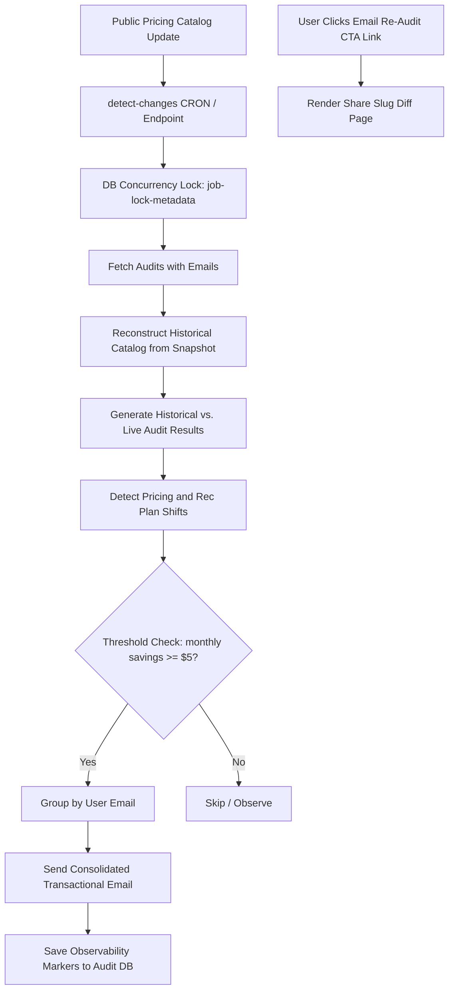

# PR: Round-2 Re-Audit on Pricing Change System

## Executive Summary
This Pull Request implements the **Re-Audit on Pricing Change System**, completing the Round-2 B2B SaaS AI Spend Platform extension. The system enables StackTrim to dynamically detect changes in public vendor pricing catalogs, evaluate their impact on stored historical audits, safely notify affected customers in a consolidated, rate-limited email blast, and provide a premium side-by-side comparative dashboard interface.

All calculations are **100% deterministic**, adhering strictly to StackTrim's core engineering principles by eliminating any AI heuristic calculations or math hallucinations.

---

## Architectural Deep Dive

### 1. Isolated Context & Recalculation Pipeline (`src/lib/engine/`)
- **`catalog.ts`, `pipeline.ts`, `analyzer.ts`**: Cleanly extended to support request-scoped `EngineContext` (which carries custom dynamic pricing catalogs). This decouples audit calculations from the global catalog state, allowing historical catalog reconstruction and isolated live comparisons.
- **Snapshot Minimizer**: Captures only the sub-catalog mapping for tools and plans used in each audit. Persisted in both the dedicated `pricing_snapshot` column and a JSONB fallback key (`metadata.pricingSnapshot`) for maximum backwards compatibility.

### 2. Change Detection & Delta Mathematics (`src/lib/engine/change-detection.ts`)
- **Catalog Reconstruction**: Restores the historical catalog state directly from the stored snapshot, filling missing items from the active live catalog as safety fallbacks.
- **Deltas & Strategy Changes**: Calculates `savingsDelta` and triggers `hasChanges` when the monthly savings shift is `>= $5` (monthly) / `>= $60` (annual) OR a recommended plan ID differs.

### 3. Serverless Concurrency Guard (`src/app/api/detect-changes/route.ts`)
- **Distributed DB Lock**: Because Next.js serverless routes cannot use in-memory locks, we utilize a database-backed locking row (`slug: 'job-lock-metadata'`) with a `5-minute` lock timeout config.
- **Dry Run Diagnostics**: An administrative parameter (`?dryRun=true`) prints complete analytical reports of affected users, audits, and planned notifications without issuing Resend API emails or mutating database states.

### 4. Consolidated Email Dispatch (`src/lib/email/`)
- **Rate Limiting & Safety**: Triggers batch throttling delays (`200ms` between users) to prevent Resend API rate limits from being reached.
- **Observability Markers**: Once sent, audits are stamped with metadata tracking `lastNotificationTimestamp`, `lastNotificationReason`, and `lastNotificationDelta` to prevent dual notification loops.

### 5. Side-by-Side Comparison UI Dashboard (`src/app/share/[slug]/diff/page.tsx`)
- **State Badges**: Renders custom statuses including **Savings Increased**, **Recommendation Updated**, and **Review Suggested**.
- **No Action Trust Screen**: Displays a comforting verified trust indicator with timestamp when live audits show that the client's stack remains 100% optimal.
- **Signal-to-Noise Ratio**: Mutes and collapses unchanged tools under a clean, grouped accordion component, highlighting only modified plan recommendations.

---

## Schema Changes & JSONB Resilience
To ensure zero-downtime operations, the implementation supports writing both to explicit column schemas and the fallback JSONB block (`metadata`):
- **`user_email`** / **`metadata.userEmail`**: Populated securely upon lead capture.
- **`pricing_snapshot`** / **`metadata.pricingSnapshot`**: Persisted on audit creation.

---

## Verification & QA
- **TypeScript**: 100% compilation clean (`npx tsc --noEmit` returns zero errors).
- **Unit & Regression Testing**: 188/188 test suites pass successfully, covering:
  - Catalog reconstruction from minimized snapshots.
  - Concurrency locking timeouts and lock acquisition.
  - Correct threshold boundary checking (monthly `$5` delta).
  - Accurate recommendation strategy difference checks.
